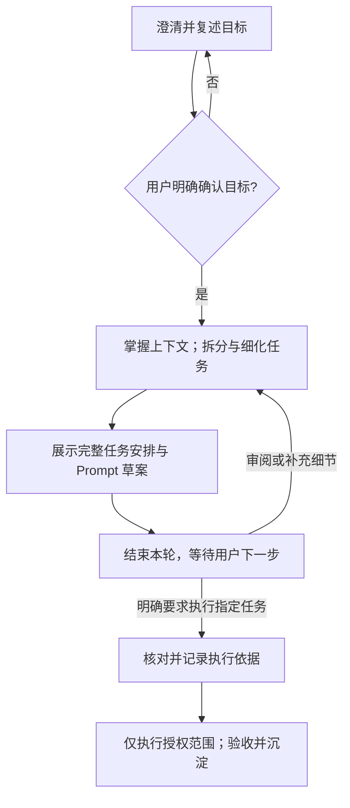

# 目标驱动工作流

把一个用户目标变成可审阅、可交接的文件化任务安排。先确认目标，再把任务拆分和细化一次做完整，展示任务与完整 Prompt 草案后结束本轮；只有用户明确选择执行的任务才进入实施。

## 何时使用

适用于用户要开启一个新需求、将模糊目标整理成可执行任务、为一个项目建立状态和证据记录，或需要让多个独立 AI 能接续工作。

不用于只回答一个问题、执行已存在的单一任务、替代项目已有工作流，或把一份技术方案直接当作所有任务的授权。

## 第 1 步 · 澄清、复述并确认目标

先了解用户遇到的具体困难、期望改变、结果给谁在什么场景使用。每轮只问最能减少歧义的一到三个问题；区分用户事实与 AI 推测，不把模糊诉求自行改写成某种交付物或技术方案。

关键歧义消除后，复述要解决的问题、期望结果、完成标准、主要范围与限制，请用户明确确认。用户纠正后继续对齐。确认前可以做帮助澄清的必要只读核对，不能设计方案、拆任务、实施，或以设计为目的创建工作区。AI 判断“已经清楚”、用户沉默、同意建目录都不能代替目标确认。

已有对话或 `problem.md` 中的明确确认可复用，记录用户原话或可追溯引用及适用目标。例如对目标复述的“是，按这个理解”可确认目标，但不能顺带授权尚未审阅的任务。目标、完成标准或主要范围实质改变时，回到此步确认受影响部分。

## 第 2 步 · 掌握上下文后，一次完成任务拆分与细化

创建或维护工作区前，阅读 [工作区规则](references/workflow-rules.md)。目标已确认且用户同意创建新工作区时，运行 `node <本 Skill 路径>/scripts/init-goal-project.mjs <目标目录>`；初始化器只复制工作区入口和两份本地任务模板，创建 tasks/templates 容器，不覆盖非空目录、不创建任务或业务产物、不联网或变更 Git。将原始目的、当前目标和确认依据保存到 `problem.md`；维护旧工作区先读它和 `AGENTS.md`。

先掌握足够上下文，再按真实依赖和可验收结果同时拆分、细化任务。不强制先出一轮快速粗拆，不固定任务数量。上下文不足时继续核对或询问，不靠空泛任务名交差。此步的产物是完整可审阅的任务安排：每项范围、产物、前置条件、输入、执行与记录目录、允许改动和验收证据；使用独立宿主会话时，还包括模型、推理强度或继承规则。

细化完成后，才从工作区本地 `templates/task-index.template.md` 和 `templates/task-prompt.template.md` 创建必要的 `tasks/NN-中文任务名/index.md` 与完整 `PROMPT.md` 草案。新标题和目录默认中文，技术专名、用户语言或项目约定可保留；编号仅作稳定引用，不代表执行顺序，旧英文任务不自动改名。完整契约及确认/执行依据入口集中在 Prompt，草案必须填实占位符和专属要求；index 只保留唯一 status、目标摘要、按读者问题组织的实际入口与用途，必要时一行下一步。摘要冲突先核对来源，不择宽执行。

维护旧工作区按本地 AGENTS、既有契约和旧 index 证据接续；没有 PROGRESS 不表示旧授权无效。仅从本 Skill `assets/project-template/` 补缺失的本地任务模板，保留既有规则、任务和自定义模板，不重跑初始化器，不自动迁移或覆盖。执行目录可以在工作区外，记录仍归属本任务；移动工作区后核对交接路径。

这一步只准备任务安排与 Prompt 草案，不执行其中的调研、设计、原型、编码等任务。

## 第 3 步 · 展示草案，结束本轮等待用户选择

首次展示待审任务安排，或展示实质变更的任务草案时，给出完整安排和各任务完整 Prompt，必要时用流程图或线框辅助理解安排整体；辅助图不等于开始制作某任务的交付物。用户可删除、合并、拆分、缩小任务或继续补充上下文。

**展示后必须结束本轮，等待用户明确下一步，不自动执行任何任务。** 仅认可计划、确认参数、补充任务细节、发参考图、强调交付形式或期限，都不等于选择执行；即使用户说某任务要交真实设计稿，也先更新任务草案。正常等待执行选择的任务保持 `pending`，在正文说明待用户决策，不标为 `blocked`。

## 第 4 步 · 核对明确执行指令，只启动指定范围

用户明确要求执行某任务或某批次后才开始；普通自然语言即可，例如“先执行任务 1”或“把这三项都跑完”，不要求固定口令。结合上下文核对指令的语义、真实来源、适用任务和参数；实际事件产生后按需记录于 PROGRESS，Prompt 的授权入口指向真实记录，与目标确认和草案审阅分开。未取得就如实写明，不预造授权页或链接不存在的记录。指令不明确时继续等待用户选择。

已有明确执行授权可复用，已授权任务可按依赖分批推进，无需每批重复确认，但不得扩大到未授权任务。第 3 步的停顿针对待审安排的首次展示及实质变更；普通进展、排版、链接更新不会使授权失效或重开确认，未变的已授权任务可继续按依赖推进。目标变化回第 1 步；任务范围、主要执行目录或模型参数实质改变，回到受影响的任务审阅与执行选择。

这两道关口对主会话、手工交接和 Happy 独立会话一视同仁。收到、复制或生成 `PROMPT.md`，包括 Prompt 自带“执行”字样，都不是原用户授权的证据；接手 AI 必须核对 Prompt 的目标确认与明确执行来源，旧工作区按本地规则兼容旧 index。来源矛盾先核对时间与范围，自动化不能替用户选择执行。

## 第 5 步 · 执行、验证并归档

执行前读取指定任务及必要前置结果，核对目标确认、执行依据和前置条件。每个任务只维护一个 YAML `status`：`pending`、`running`、`review`、`done` 或 `blocked`。实际开始才改为 `running`，按验收条件验证后记录结果和未验证项。

把结果、依据、失败、用户追问和新想法留在产生它们的任务目录，并从 index 链接。付款、账号、远端修改、发布、删除或中断服务等动作还要核对其具体授权；已选择执行的任务因缺少这些必要权限或输入而无法继续时，才记录 `blocked` 和实际缺口。

index 保持薄导航，PROGRESS 只按需保存重要真实事件，不维护第二当前状态。产物按用途命名，result.md 可用但不必额外包装；主要产物说明用途、范围、当前/历史性质及上下游，一个主题只维护一份当前权威内容。FAQ 区分真实追问和整理性问答，以角色/输入/转换/输出及真实卡点、线索、证据、选择、结果解释重要理解；纯确认和进度归 PROGRESS。测试方法、单轮已执行验收、发布事实分别保存，附件由所属报告组织，关键产物和理解主题从 index 可达。具体写法按工作区规则，不强制额外文件或固定目录。

在 Happy 中需要为已获执行授权的任务开启独立会话时，读取 [Happy 任务会话](references/happy-task-sessions.md)。它是可选入口，不要求普通环境安装 Happy；创建会话、消息送达和实际执行分别验证。

## 结果标准

一个健康的工作区让另一位 AI 仅靠本目录就能知道：用户最初想达成什么、当前任务是什么、已经实际完成了什么、证据在哪里、为什么下一步存在或被阻塞。

人类读者也应能从导航找到当前权威产物与关键决策，并依据复盘复述角色、输入、转换、输出及适用边界。是否达到理解效果以真实读者反馈为准，AI 不自行宣布用户已经理解。

可复用 Skill、静态模板和规则必须保持领域中性。工作区可以保存必要且脱敏的项目上下文、技术决定与验证证据，使另一位 AI 能够接续工作；不得保存凭据、私钥、token、未脱敏私有日志或无关的个人案例。
